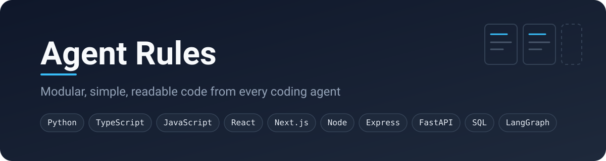

# Agent Rules



Rules for coding agents (Claude Code, Codex, Cursor, Copilot, Gemini CLI and
others) so the code they write is modular, simple and easy to read.

---

## Which files a project needs

Every project uses all of `core/`, plus its language, its database and its
frameworks. `AGENTS.md` is the index agents use to pick the right files.

| Project | Files besides `core/` |
|---|---|
| Next.js app | `typescript.md`, `react.md`, `nextjs.md`, `sql.md`, and `postgresql.md` or `mysql.md` |
| React app with no Next.js | `typescript.md`, `react.md` |
| Express API | `typescript.md`, `node.md`, `express.md`, `sql.md`, and `postgresql.md` or `mysql.md` |
| FastAPI service | `python.md`, `fastapi.md`, `sql.md`, and `postgresql.md` or `mysql.md` |
| LangGraph agent | `python.md` or `typescript.md`, `langgraph.md` |
| Plain JavaScript project | `javascript.md`, plus its frameworks |

---

## How to use it in a project

**1. Copy this whole repo** into the project as `agent-rules/`, including its
`AGENTS.md` index.

**2. Make `AGENTS.md`** at the project root. Most agent tools read this file.

```markdown
# Rules

Before writing any code, read `agent-rules/AGENTS.md` and follow it.
```

**3. Make `CLAUDE.md`** at the project root, holding one line:

```markdown
@AGENTS.md
```

Claude Code reads `CLAUDE.md`, which loads `AGENTS.md`. Other tools read
`AGENTS.md` directly. Either way, the agent reaches the index in
`agent-rules/AGENTS.md`, reads the core files, and opens only the language,
database and framework files that match the task. Unused rules never fill up
its context.

---

## How each rules file is laid out

1. **The rules:** a short numbered list.
2. **Naming:** a table of what to call each kind of thing.
3. **Folder layout:** a real example tree.
4. **Examples:** real code, and good next to bad.
5. **Before you commit:** a yes or no checklist the agent checks its work
   against.

Language and framework files never repeat `core/`. They cover only what is
special to them.
